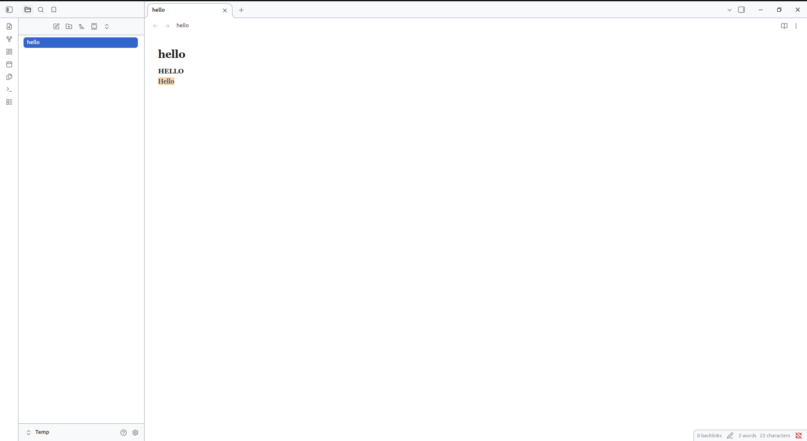

# Cozy Journal

A clean, minimalist reading and journaling theme for Obsidian inspired by the Wikipedia design language. Features a dual-palette system: a crisp **Wikipedia Light Mode** and a high-contrast **OLED Pure Black Dark Mode** with soft blue accents — no plugins required.

> **Version:** 1.2.5 · **Author:** [OmkarShirse](https://github.com/OmkarShirse) · **License:** MIT

---

## ✨ Features

- **Dual-Theme Wikipedia Aesthetic:**
  - **Light Mode:** Classic Wikipedia paper `#ffffff` background, `#f8f9fa` secondary panels, `#a2a9b1` borders, and Wikipedia blue (`#3366cc`) links.
  - **Dark Mode:** Pure OLED black (`#000000`) base, high-contrast crisp text (`#eaecf0`), and soft blue (`#81a8f8`) links.
- **High-Contrast & Legible UI:** Form fields, dropdowns, command palettes, and modals feature subtle elevation and defined borders so text never blends into the background.
- **Minimalist List Bullets:** Clean `➤` arrow markers in subtle muted tones.
- **Cozy Typography:** Elegant serif reading font (Georgia / Iowan Old Style) for long-form writing, paired with JetBrains Mono / Fira Code for code blocks.
- **Clean Link Styling:** Underline-free links for cleaner reading; underlines appear smoothly on hover. Unresolved internal links stand out in classic Wikipedia red (`#ba0000` in light, `#ff6e6e` in dark).
- **Subtle Image Hover Zoom:** Images feature rounded corners (`15px`) and smooth scale-up zoom on hover with no intrusive borders.
- **Redesigned Sidebar & Tabs:** Rounded tiles with clean hover states and navy/blue active highlights.
- **Justified Text:** Evenly balanced paragraphs and lists in both Reading View and Live Preview.
- **Hidden Frontmatter Box:** Note properties/metadata panel hidden by default for a clutter-free reading experience.
- **Lightweight & Fast:** Respects Obsidian native heading scales and readable line lengths without bloated CSS or `!important` hacks.

---

## 🚀 Installation

1. Download `manifest.json` and `theme.css`.
2. In your vault, create the folder: `.obsidian/themes/Cozy Journal/`
3. Place both files inside.
4. In Obsidian: **Settings → Appearance → Themes → select Cozy Journal**.
5. Switch freely between **Light** and **Dark** in **Settings → Appearance → Base color scheme**.

---

## 🛠 Customization

You can customize core CSS variables at the top of `theme.css`:

| Variable | Light Default | Dark Default | Purpose |
|---|---|---|---|
| `--background-primary` | `#ffffff` | `#000000` | Main editor background |
| `--background-secondary` | `#f8f9fa` | `#000000` | Sidebar & tabs background |
| `--text-normal` | `#202122` | `#eaecf0` | Main body text |
| `--link-color` | `#3366cc` | `#81a8f8` | Internal and external links |
| `--link-unresolved-color` | `#ba0000` | `#ff6e6e` | Missing / unresolved note links |
| `--interactive-accent` | `#3366cc` | `#21426e` | Active tab and selection highlight |
| `--font-text` | Georgia, serif | Georgia, serif | Body text font |
| `--font-monospace` | JetBrains Mono | JetBrains Mono | Code block font |

---

## 📋 Changelog

### v1.2.5
- **Dual Mode Overhaul:** Added complete Wikipedia Light Theme and redesigned Dark Theme.
- **Soft Blue Links:** Wikipedia blue links (`#3366cc` in light, `#81a8f8` in dark) with red unresolved link indicators.
- **Fixed Dark Contrast:** Redesigned inputs, modals, menus, and dropdowns with distinct borders and crisp typography so text is never invisible.
- **Minimalist Bullets:** Updated list bullet markers to clean `➤` arrows.
- **Cleaner Images:** Removed white image borders; retained smooth 15px radius and hover zoom.
- **Zero Lint Warnings:** Removed all `!important` overrides for optimal Obsidian theme compliance.

### v1.2.2
- Neutral dark palette improvements and removal of warm yellow casts.

### v1.2.0
- Initial Cozy Journal dark theme release.

---

## 📄 License

MIT
